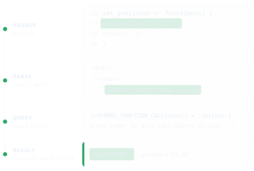
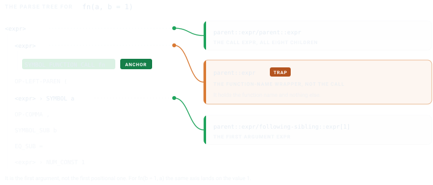
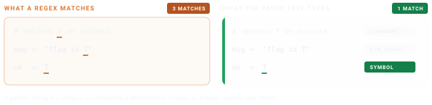

# Writing Your Own Checks

checktor knows CRAN’s rules, and your team still has rules of its own.
Perhaps you have banned a function, insist on a file header or keep
relapsing into a habit. The helpers in `R/ast.R` and `R/rd.R` let you
write a check for such a rule in a few lines of XPath against the parsed
syntax tree, and
[`checktor()`](https://r-pkg.thecoatlessprofessor.com/checktor/reference/checktor.md)
handles the bookkeeping.

Every check follows the same path. checktor parses your sources once
into a syntax tree, and an XPath query picks out the nodes you object
to. Each match comes back as a `file:line` string inside a result that
knows how to print itself. The figure traces that path for a built-in
check, the one that flags an
[`options()`](https://rdrr.io/r/base/options.html) call whose function
never restores the setting.



## Shape a check

Name a check `lab_<name>()`, where `<name>` is the name
[`checktor()`](https://r-pkg.thecoatlessprofessor.com/checktor/reference/checktor.md)
reports in `tidy()$check` and the name `Config/checktor` fields use.
Keeping the two the same means a reader who sees a finding knows which
function to call. The five category functions keep their own names,
since each runs a whole panel rather than one check. Four are
`diagnose_<category>_issues()`, and the policy panel is
[`diagnose_policy_violations()`](https://r-pkg.thecoatlessprofessor.com/checktor/reference/diagnose_policy_violations.md).

Checks built on the exported helpers follow this contract.

``` r
lab_<name> <- function(path, verbose = TRUE, parsed = NULL) {
  if (is.null(parsed)) parsed <- read_r_xml(path)
  if (length(parsed) == 0L) {
    return(checktor_check_result(TRUE, character(0), "<message>"))
  }
  # ... XPath logic ...
  checktor_check_result(passed, issues, "<message>")
}
```

> The `parsed` argument takes an optional parse cache. When
> [`checktor()`](https://r-pkg.thecoatlessprofessor.com/checktor/reference/checktor.md)
> runs the code checks together, it parses each file once and hands the
> result to every check that asks for it. On a 200-file package, that
> means 200 parses in all rather than 200 for every check.

## Use the helpers

`R/ast.R` holds the shared machinery and `R/rd.R` the help-page walkers.
The helpers below appear in roughly the order of the path above.
[`read_r_xml()`](https://r-pkg.thecoatlessprofessor.com/checktor/reference/read_r_xml.md)
parses and
[`xpath_lints()`](https://r-pkg.thecoatlessprofessor.com/checktor/reference/xpath_lints.md)
queries, and between them they do most of the work in every check that
reads `R/`. The rest are shorthands for patterns common enough to earn a
name. The first two are enough to write a check.

### `read_r_xml(path)`

This is what makes your sources queryable. It parses every `R/*.R` file
in the package and returns a named list of `list(file, xml, error)`.
Files that fail to parse keep their condition in `error` instead of
stopping the run.

``` r

parsed <- read_r_xml(".")
str(parsed[[1]], max.level = 1)
#> List of 3
#>  $ file : chr "./R/bar.R"
#>  $ xml  :List of 2
#>   ..- attr(*, "class")= chr [1:2] "xml_document" "xml_node"
#>  $ error: NULL
```

The `xml` slot is an `xml2` document produced by
[`xmlparsedata::xml_parse_data()`](https://rdrr.io/pkg/xmlparsedata/man/xml_parse_data.html).
Every parse-tree token is an XML element with `line1`, `col1`, `line2`
and `col2` attributes.

### `xpath_lints(parsed, xpath, label = NULL)`

This is the workhorse. Give it an XPath query and it returns a
`"basename:line"` string for every match in every file, ready for a
check result’s `$issues`. The optional `label` appears in parentheses
after each hit.

``` r

xpath_lints(parsed, "//SYMBOL_FUNCTION_CALL[text() = 'set.seed']")
#> [1] "bar.R:17" "foo.R:42"
```

### `undesirable_function_check(parsed, funs, label = TRUE)`

The most common pattern, flagging any call to a given function, has a
helper of its own.

``` r

undesirable_function_check(parsed, c("install.packages", "browser"))
#> [1] "foo.R:4 (install.packages())" "foo.R:5 (browser())"
```

It is checktor’s counterpart to lintr’s `undesirable_function_linter()`.

### `not_under_fn_with_call_xpath(funs)`

It returns an XPath predicate that keeps only the nodes whose
*innermost* enclosing function does not also call one of `funs`.
`option_changes` uses it to require an
[`on.exit()`](https://rdrr.io/r/base/on.exit.html) beside each
[`options()`](https://rdrr.io/r/base/options.html) call in the same
function. The word innermost matters for nested functions, where an
[`on.exit()`](https://rdrr.io/r/base/on.exit.html) in the outer function
does not cover the inner one.

``` r

predicate <- not_under_fn_with_call_xpath(c("on.exit", "local_options"))
xpath <- paste0(
  "//SYMBOL_FUNCTION_CALL[text() = 'options']",
  "[", predicate, "]"
)
```

### `extract_rd_section(rd, tag)` and `collect_rd_text(node, skip)`

These walk `.Rd` files by structure through
[`tools::parse_Rd()`](https://rdrr.io/r/tools/parse_Rd.html), and both
live in `R/rd.R`. If you read `man/` yourself, you see every help page,
including any that `.Rbuildignore` keeps out of the tarball. The
built-in checks skip those pages, so skip them too if your check should
judge only what CRAN receives.

``` r

rd <- tools::parse_Rd("man/my_fn.Rd")
ex <- extract_rd_section(rd, "\\examples")
collect_rd_text(ex, skip = "\\dontrun")
```

## Build a check for `Sys.setenv()`

Suppose you want to flag any
[`Sys.setenv()`](https://rdrr.io/r/base/Sys.setenv.html) call whose
enclosing function does not also call `on.exit(Sys.unsetenv(...))` or
[`withr::local_envvar()`](https://withr.r-lib.org/reference/with_envvar.html).
That is the same shape as
[`lab_option_changes()`](https://r-pkg.thecoatlessprofessor.com/checktor/reference/lab_option_changes.md),
and checktor includes it as
[`lab_sys_setenv()`](https://r-pkg.thecoatlessprofessor.com/checktor/reference/lab_sys_setenv.md).
Its core looks like this.

``` r

lab_sys_setenv <- function(path, verbose = TRUE, parsed = NULL) {
  # reuse the parse-cache when checktor() supplies one, else parse fresh
  if (is.null(parsed)) parsed <- read_r_xml(path)
  if (length(parsed) == 0L) {
    return(checktor_check_result(TRUE, character(0),
                                 "Sys.setenv reset check"))
  }
  xpath <- paste0(
    "//SYMBOL_FUNCTION_CALL[text() = 'Sys.setenv'][",
    # keep only calls whose enclosing function never resets the variable
    "  ", not_under_fn_with_call_xpath(c(
        "on.exit",
        "Sys.unsetenv",
        "local_envvar", "with_envvar"
      )),
    "]"
  )
  issues <- xpath_lints(parsed, xpath)
  passed <- length(issues) == 0L
  # a built-in check also calls emit_issue_summary(issues, verbose, ...) here
  # to print the cli summary when verbose = TRUE
  checktor_check_result(passed, issues, "Sys.setenv reset check")
}
```

It runs to about twenty lines, and the XPath predicate is the only
interesting one. The rest is bookkeeping every check shares. The
built-in version adds one refinement. It exempts a setter that captures
the old value and hands it back
(`old <- get_env(); Sys.setenv(...); invisible(old)`), since the caller
can then restore it and nothing leaks. Refinements like that are where a
real check earns its keep, but the skeleton is this one.

## Navigate the parse tree

`fn(a, b = 1)` parses to this tree.

``` xml
<expr>                              <!-- call expr -->
  <expr>                            <!-- function-name expr -->
    <SYMBOL_FUNCTION_CALL>fn</SYMBOL_FUNCTION_CALL>
  </expr>
  <OP-LEFT-PAREN>(
  <expr><SYMBOL>a</SYMBOL></expr>   <!-- first positional arg -->
  <OP-COMMA>,
  <SYMBOL_SUB>b</SYMBOL_SUB>        <!-- named-arg name -->
  <EQ_SUB>=</EQ_SUB>
  <expr><NUM_CONST>1</NUM_CONST></expr>  <!-- named-arg value -->
  <OP-RIGHT-PAREN>)
</expr>
```

Anchor on the `SYMBOL_FUNCTION_CALL` and every other node is one axis
away. The amber card in the figure marks the axis that catches people
out.

![The parse tree for fn(a, b = 1), anchored on its SYMBOL_FUNCTION_CALL
node. parent::expr reaches only the function-name wrapper, marked as the
trap. parent::expr/parent::expr reaches the call expr, and
parent::expr/following-sibling::expr\[1\] reaches the first
argument.](figures/xpath-axes-light.svg)

- the call expr is `parent::expr/parent::expr`
- the first argument expr is `parent::expr/following-sibling::expr[1]`
- a named argument’s name is `parent::expr/parent::expr/SYMBOL_SUB`

The middle axis finds the first *argument*, which is not always the
first *positional* argument. For `fn(b = 1, a)` it lands on the value
`1`, so use it only when you already know the shape of the call.

## Try a query

Two calls are enough to try a query on your own package.

``` r

# Parse a file
parsed <- read_r_xml("path/to/package")

# Find every call to install.packages()
xpath_lints(parsed,
            "//SYMBOL_FUNCTION_CALL[text() = 'install.packages']")
```

## Register the check

Your finished `lab_*()` function does nothing until
[`checktor()`](https://r-pkg.thecoatlessprofessor.com/checktor/reference/checktor.md)
knows to call it.
[`register_check()`](https://r-pkg.thecoatlessprofessor.com/checktor/reference/register_check.md)
connects the two at run time, without editing checktor’s source.

``` r

lab_my_check <- function(path, verbose = TRUE, parsed = NULL) {
  if (is.null(parsed)) parsed <- read_r_xml(path)
  issues <- undesirable_function_check(parsed, "banned")
  checktor_check_result(length(issues) == 0L, issues, "no banned()")
}

register_check("my_check", lab_my_check,
               category = "code", severity = "policy")
```

From then on, every
[`checktor()`](https://r-pkg.thecoatlessprofessor.com/checktor/reference/checktor.md)
run includes `my_check`. It appears under that name in
[`issues()`](https://r-pkg.thecoatlessprofessor.com/checktor/reference/issues.md),
[`tidy()`](https://generics.r-lib.org/reference/tidy.html) and the
printed report, and the severity you gave it decides whether it counts
toward overall health.

Registered checks work under a few rules.

- The function returns a
  [`checktor_check_result()`](https://r-pkg.thecoatlessprofessor.com/checktor/reference/checktor_check_result.md),
  the same shape as every built-in check, so `run_checks()` can catch
  its errors and keep its `$passed` record.
- checktor calls it as `fn(path, verbose)`. If the function also
  declares `parsed` (for `code` and `policy` checks) or `desc` (for
  `description` checks), it receives the shared cache and reuses the one
  parse instead of reading the sources again.
- `category` is one of `code`, `description`, `documentation`, `general`
  or `policy`. The check runs after that category’s built-in checks.
- `severity` is `policy`, `robustness` or `opinion`, and defaults to
  `robustness`. It decides whether a finding counts against overall
  health under
  [`checktor()`](https://r-pkg.thecoatlessprofessor.com/checktor/reference/checktor.md)’s
  `severity` argument.
- Checks that cannot run where they are should report a skip, not a
  pass. They might need a network, a program or a credential that is
  missing. Return
  `checktor_check_result(TRUE, character(0), "<message>", skipped = TRUE, skip_reason = "<why>")`.
  It then shows as skipped in
  [`tidy()`](https://generics.r-lib.org/reference/tidy.html),
  [`summary()`](https://rdrr.io/r/base/summary.html), the printed
  report,
  [`health_report()`](https://r-pkg.thecoatlessprofessor.com/checktor/reference/health_report.md)
  and
  [`ci_report()`](https://r-pkg.thecoatlessprofessor.com/checktor/reference/ci_report.md).
- `options(checktor.disable = "my_check")` or `Config/checktor/disable`
  turns a registered check off, as it does a built-in one.
- [`prescribe()`](https://r-pkg.thecoatlessprofessor.com/checktor/reference/prescribe.md)
  has no treatment for a registered check, so it lists the findings
  without a remedy.

[`registered_checks()`](https://r-pkg.thecoatlessprofessor.com/checktor/reference/registered_checks.md)
lists what is registered, and `unregister_check("my_check")` removes
one. Called with no argument,
[`unregister_check()`](https://r-pkg.thecoatlessprofessor.com/checktor/reference/unregister_check.md)
removes them all. The registry lasts for the session, so call
[`register_check()`](https://r-pkg.thecoatlessprofessor.com/checktor/reference/register_check.md)
somewhere that runs before you need the check, such as a project
`.Rprofile`, your own package’s `.onLoad()` or the top of a CI script.

The helpers on this page are all exported, so a registered check can use
the same ones the built-in checks use. They are
[`read_r_xml()`](https://r-pkg.thecoatlessprofessor.com/checktor/reference/read_r_xml.md),
[`xpath_lints()`](https://r-pkg.thecoatlessprofessor.com/checktor/reference/xpath_lints.md),
[`xpath_per_file()`](https://r-pkg.thecoatlessprofessor.com/checktor/reference/xpath_per_file.md),
[`undesirable_function_check()`](https://r-pkg.thecoatlessprofessor.com/checktor/reference/undesirable_function_check.md),
[`not_under_fn_with_call_xpath()`](https://r-pkg.thecoatlessprofessor.com/checktor/reference/not_under_fn_with_call_xpath.md)
and the `.Rd` walkers
[`extract_rd_section()`](https://r-pkg.thecoatlessprofessor.com/checktor/reference/extract_rd_section.md)
and
[`collect_rd_text()`](https://r-pkg.thecoatlessprofessor.com/checktor/reference/collect_rd_text.md).

> To contribute a check to checktor itself, skip the registry and add it
> the way the built-in checks are added.
>
> 1.  Write `lab_my_check()` in the matching `R/diagnostics-*.R` file.
> 2.  Add a `check_row()` for it to `BUILTIN_CHECKS` in `R/registry.R`.
>     The row gives the category, the severity, the label its result
>     reports as `$message` and when it runs. Set `reads_desc = TRUE`
>     for a check that reads the parsed `DESCRIPTION`, so it is reported
>     as skipped under its label when R cannot read the file.
> 3.  Add its remedy to `R/treatments.R`, which
>     [`prescribe()`](https://r-pkg.thecoatlessprofessor.com/checktor/reference/prescribe.md)
>     and
>     [`health_report()`](https://r-pkg.thecoatlessprofessor.com/checktor/reference/health_report.md)
>     print.
> 4.  Add a `*_bad` scenario under `inst/diagnose/` for its example, and
>     a row to [Where the Checks Come
>     From](https://r-pkg.thecoatlessprofessor.com/checktor/articles/check-sources.md).
>
> The category function runs its rows in table order and passes `parsed`
> or `desc` to a check whose signature takes it. Checks that should not
> run every time set `when` in their row. Use `console` or `backend` for
> a check that needs the network or an external program, and have it
> return `checktor_skipped_result()` when it cannot run. Use `request`
> for a check that should run only when called, which keeps it out of
> every run. `test-severity.R` holds the table, and the vignette’s copy
> of it, to what runs.

## Configure an existing check

Some house rules need no new check, because a package can configure
checktor from `Config/checktor/*` fields in its own `DESCRIPTION`. Each
field is a comma-separated list. `DESCRIPTION` has no comment syntax, so
keep notes out of the field, or anything after the last name becomes
part of it.

``` yaml
Config/checktor/software_names: brms, cmdstanr
Config/checktor/acronyms: MCMC, GLMM
Config/checktor/allow: urls:README.md
Config/checktor/disable: news_file
```

`software_names` adds names to flag when they appear unquoted, and
`acronyms` adds domain acronyms to accept without explanation. Each
extends the word list its check already uses, and `language_names` and
`format_names` work the same way. `allow` mutes findings, either a whole
check or a `check:substring`, which a green
[`checkup()`](https://r-pkg.thecoatlessprofessor.com/checktor/reference/checkup.md)
gate needs once someone has reviewed and accepted a finding. `disable`
turns a check off, so it does not run and is not counted. To turn a
check off in every package rather than one, set
`options(checktor.disable = "news_file")` once, for example in
`.Rprofile`. checktor combines the option with the field.

Write a check of your own when the rule is yours alone. Use
`Config/checktor/*` when you only need to teach or quiet a check
checktor already has.

## Trust the parse tree

Working on the parse tree is what keeps checktor’s checks precise.
Patterns inside a string literal or a comment are a different kind of
node from a real call, so a query for the call never matches them.



Write the XPath and let checktor carry the rest. Your house rule then
gets the same reports and the same `Config/checktor` controls as the
built-in checks.

## See also

- [Getting Started with
  checktor](https://r-pkg.thecoatlessprofessor.com/checktor/articles/getting-started-with-checktor.md):
  checktor from a user’s side, from a first checkup to a written report.
- [checktor in Continuous
  Integration](https://r-pkg.thecoatlessprofessor.com/checktor/articles/checktor-in-ci.md):
  run
  [`checkup()`](https://r-pkg.thecoatlessprofessor.com/checktor/reference/checkup.md)
  as a build gate.
- [`?xmlparsedata::xml_parse_data`](https://rdrr.io/pkg/xmlparsedata/man/xml_parse_data.html),
  and the lintr guide to [writing
  linters](https://lintr.r-lib.org/articles/creating_linters.html),
  which covers the same patterns at a larger scale.
