# Getting Started with checktor

## Close the gap

`R CMD check` tells you whether your package builds, installs and runs.
CRAN volunteers also read each new package by hand, and they ask for
more. They object to a help page with no `\value{}`, a
[`set.seed()`](https://rdrr.io/r/base/Random.html) buried inside a
function and a Description one line long. `R CMD check` passes all three
without a word, and any one of them can send a package back.



checktor holds your package to the rules reviewers apply by hand. They
come from the [CRAN Repository
Policy](https://cran.r-project.org/web/packages/policies.html), [Writing
R
Extensions](https://cran.r-project.org/doc/manuals/r-release/R-exts.html)
and the [CRAN
Cookbook](https://contributor.r-project.org/cran-cookbook/), the R
Contributor guide to the problems that get packages sent back. Use it
alongside `R CMD check`, which remains the authority on whether a
package builds and runs, and [lintr](https://lintr.r-lib.org), which is
the place for code style.

## Install checktor

Install the release from CRAN.

``` r

install.packages("checktor")
```

The development version carries changes that have not reached CRAN yet.
Install it from GitHub.

``` r

# install.packages("pak")
pak::pak("coatless-rpkg/checktor")
```

## Run a first checkup

Load the package.

``` r

library(checktor)
```

[`checktor()`](https://r-pkg.thecoatlessprofessor.com/checktor/dev/reference/checktor.md)
examines a package directory. Rather than experiment on your own
package, start with a throwaway one.
[`example_diagnose_scenario()`](https://r-pkg.thecoatlessprofessor.com/checktor/dev/reference/example_diagnose_scenario.md)
builds a small package around one file of bad habits and returns its
path.

``` r

pkg <- example_diagnose_scenario("code_examples/tf_usage_bad.R",
                                 show_content = FALSE)
```

The file uses `T` and `F` where it means `TRUE` and `FALSE`.

``` r

# Example file showing T/F usage issues

#' Process Data Function
#' @param data A data frame
#' @return Logical indicating success
process_data <- function(data) {
  if (is.null(data)) {
    return(F) # Issue: should be FALSE
  }

  has_complete_cases <- T # Issue: should be TRUE

  if (has_complete_cases) {
    cleaned_data <- data[complete.cases(data), ]
    return(T) # Issue: should be TRUE
  }

  return(F) # Issue: should be FALSE
}

# Another function with T/F issues
validate_input <- function(x, strict = T) {
  # Issue: should be TRUE
  if (length(x) == 0) {
    return(F)
  } # Issue: should be FALSE

  valid <- all(is.numeric(x))
  return(valid && strict == T) # Issue: should be TRUE
}
```

> [`example_diagnose_scenario()`](https://r-pkg.thecoatlessprofessor.com/checktor/dev/reference/example_diagnose_scenario.md)
> prints the file itself unless you pass `show_content = FALSE`. This
> page passes `FALSE` and shows the file above as highlighted R instead
> of console output.

Now the checkup itself.

``` r

# verbose and progress are off here, which keeps the printout compact
results <- checktor(pkg, verbose = FALSE, progress = FALSE)
results
#> ── Package Doctor - Diagnosis Summary ──────────────────────────────────────────
#> Patient: examplepackage
#> Examined: 2026-10-14 21:09:15.375261
#> Doctor version: 0.2.0.9000
#> 
#> CODE ISSUES: 1 failing check
#> DESCRIPTION ISSUES: HEALTHY
#> DOCUMENTATION ISSUES: HEALTHY
#> GENERAL ISSUES: HEALTHY
#> POLICY ISSUES: HEALTHY
#> 
#> ℹ 2 checks did not run: "spelling" and "url_liveness".
#> ! Overall health: NEEDS ATTENTION (7 issues)
#> Run `summary()`, `issues()`, or `prescribe()` for details
```

The printout marks each of the five categories (code, DESCRIPTION,
documentation, general and CRAN policy) as healthy or failing. It lists
any check that did not run and ends with the package’s overall health.
Here the code category fails on seven uses of `T` and `F`.
`url_liveness` did not run, because it fetches URLs only when you are at
the console.

Each check has one of three severities. `policy` marks a rule CRAN
applies, `robustness` a defect CRAN would still accept, and `opinion` a
convention. By default, overall health counts policy and robustness
findings and leaves opinion findings out of the count.


[Where the Checks Come
From](https://r-pkg.thecoatlessprofessor.com/checktor/dev/articles/check-sources.md)
gives the source and severity of every check, and the [function
reference](https://r-pkg.thecoatlessprofessor.com/checktor/reference/index.html)
documents each one.

> On your own package, call
> [`checktor()`](https://r-pkg.thecoatlessprofessor.com/checktor/dev/reference/checktor.md)
> with no arguments. It finds the package root from anywhere inside it,
> so a working directory of `R/` or `tests/testthat/` still examines the
> whole package.

## Read the results as data

The printed report is for people. To filter, count or reshape the
findings, use the accessors, which return plain data frames.



``` r

summary(results)   # one row per category
#>        category checks passed failed skipped issues
#> 1          code     16     15      1       0      7
#> 2   description     23     22      0       1      0
#> 3 documentation     17     17      0       0      0
#> 4       general      7      6      0       1      0
#> 5        policy      4      4      0       0      0
```

``` r

issues(results)    # one row per issue, with file and line
#>   category    check   severity           file line          location
#> 1     code tf_usage robustness tf_usage_bad.R    8  tf_usage_bad.R:8
#> 2     code tf_usage robustness tf_usage_bad.R   11 tf_usage_bad.R:11
#> 3     code tf_usage robustness tf_usage_bad.R   15 tf_usage_bad.R:15
#> 4     code tf_usage robustness tf_usage_bad.R   18 tf_usage_bad.R:18
#> 5     code tf_usage robustness tf_usage_bad.R   22 tf_usage_bad.R:22
#> 6     code tf_usage robustness tf_usage_bad.R   25 tf_usage_bad.R:25
#> 7     code tf_usage robustness tf_usage_bad.R   29 tf_usage_bad.R:29
#>           message
#> 1 T/F usage check
#> 2 T/F usage check
#> 3 T/F usage check
#> 4 T/F usage check
#> 5 T/F usage check
#> 6 T/F usage check
#> 7 T/F usage check
```

`tidy(results)` gives one row per check, passed or not, and
[`as.data.frame()`](https://rdrr.io/r/base/as.data.frame.html) returns
the same frame. Its `skipped` column marks a check that did not run,
such as the URL fetch above, so a check that sat out never reads as a
pass. [`summary()`](https://rdrr.io/r/base/summary.html) counts that
check as skipped, and its `passed`, `failed` and `skipped` columns add
up to `checks`.

Three helpers answer the usual questions.

``` r

is_healthy(results)
#> [1] FALSE
n_issues(results)
#> [1] 7
failed_checks(results)
#> [1] "code.tf_usage"
```

[`is_healthy()`](https://r-pkg.thecoatlessprofessor.com/checktor/dev/reference/predicates.md)
and
[`n_issues()`](https://r-pkg.thecoatlessprofessor.com/checktor/dev/reference/predicates.md)
follow the overall health, so by default they count only policy and
robustness findings.
[`issues()`](https://r-pkg.thecoatlessprofessor.com/checktor/dev/reference/issues.md)
lists findings of every severity, opinion included, and
[`failed_checks()`](https://r-pkg.thecoatlessprofessor.com/checktor/dev/reference/predicates.md)
lists every check that failed. Every accessor also works on a single
category, as in `issues(results$code_issues)`.
[`issues()`](https://r-pkg.thecoatlessprofessor.com/checktor/dev/reference/issues.md),
[`n_issues()`](https://r-pkg.thecoatlessprofessor.com/checktor/dev/reference/predicates.md),
[`is_healthy()`](https://r-pkg.thecoatlessprofessor.com/checktor/dev/reference/predicates.md)
and
[`passed()`](https://r-pkg.thecoatlessprofessor.com/checktor/dev/reference/predicates.md)
work on a single check as well.

## Gate a script on one call

[`checkup()`](https://r-pkg.thecoatlessprofessor.com/checktor/dev/reference/checkup.md)
runs the same diagnosis without printing and returns one logical, `TRUE`
when the package is in good overall health.

``` r

checkup(pkg)
#> [1] FALSE
```

It is built to end a shell one-liner. [checktor in Continuous
Integration](https://r-pkg.thecoatlessprofessor.com/checktor/dev/articles/checktor-in-ci.md)
puts it in charge of a GitHub Actions build.

## Treat what it finds

Diagnosis without treatment is only bad news.
[`prescribe()`](https://r-pkg.thecoatlessprofessor.com/checktor/dev/reference/prescribe.md)
takes each failed check in turn and prints its findings, its remedy and
a before-and-after example.

``` r

prescribe(results)
#> ── Treatment Recommendations ───────────────────────────────────────────────────
#> 
#> ── T/F Usage Issues
#> Issues found:
#> • tf_usage_bad.R:8
#> • tf_usage_bad.R:11
#> • tf_usage_bad.R:15
#> • tf_usage_bad.R:18
#> • tf_usage_bad.R:22
#> ... and 2 more
#> Treatment: Replace `T` with `TRUE` and `F` with `FALSE`
#> # Before
#> result <- T
#> # After
#> result <- TRUE
#> 
```

[`health_report()`](https://r-pkg.thecoatlessprofessor.com/checktor/dev/reference/health_report.md)
writes the same findings and remedies to a file, as Markdown, HTML or
plain text, to keep beside your `cran-comments.md`.

``` r

health_report(results, file = "package-health.md")
health_report(results, file = "package-health.html", format = "html")
```

## Examine one category at a time

Each category also runs on its own. That helps when you are fixing one
thing and would rather not hear about the rest.

``` r

diagnose_code_issues()           # just the R sources
diagnose_description_issues()    # just DESCRIPTION
diagnose_documentation_issues()  # help pages, examples, vignettes, demos
diagnose_general_issues()        # size, URLs, NEWS, README links
diagnose_policy_violations()     # CRAN policy
```

To run one check, call its `lab_*()` function, such as
[`lab_tf_usage()`](https://r-pkg.thecoatlessprofessor.com/checktor/dev/reference/lab_tf_usage.md).

## Check only what CRAN receives

`R CMD build` leaves out whatever `.Rbuildignore` matches, and checktor
leaves out the same files. Help pages and vignettes that never reach the
tarball are never checked.

The [devtag](https://github.com/moodymudskipper/devtag) package uses
this to document unexported functions. Its `@dev` tag writes the help
page and adds the `.Rd` file to `.Rbuildignore`, so contributors see the
page and users do not. Examples on those pages can call `:::` without an
objection from checktor. The pkgdown-only articles that
`usethis::use_article()` writes to `vignettes/articles/` are left out
the same way.

`roxygen_usage` is the exception. It reads all of `man/`, because it
asks whether your working tree matches roxygen, which is a question
about your files rather than the tarball.

## Turn down the volume

[`checktor()`](https://r-pkg.thecoatlessprofessor.com/checktor/dev/reference/checktor.md)
is chatty by design. In a script, quiet it once and every later call
inherits the setting.

``` r

configure_doctor(verbose_default = FALSE, progress_default = FALSE)

# or per call
results <- checktor(verbose = FALSE, progress = FALSE)
```

## Ask for a check, or turn one off

Some checks never join a run. Either no authority backs them, or they
concern your submission workflow rather than the package. Nothing tried
to run them, so they are not reported as skipped, and a quiet run does
not mention them. The results list them.

``` r

results$metadata$on_request_checks
#> [1] "cph_role"                    "cran_comments_file"         
#> [3] "description_function_quotes" "format_names"               
#> [5] "title_starts_with_article"
```

Each is a `lab_*()` function like any other check, so running one takes
one call.

``` r

lab_cran_comments_file(pkg, verbose = FALSE)
#> ✔ cran-comments file check: PASSED
```

In the other direction, you can turn off a check you have decided
against. For one package, list it in that package’s `DESCRIPTION`.

``` yaml
Config/checktor/disable: news_file
```

The same `DESCRIPTION` can mute a finding you have reviewed with
`Config/checktor/allow`, and add words to a check’s list with fields
such as `Config/checktor/software_names`. These settings travel with the
package, so they apply wherever it is checked.


For every package, set the option once, for example in `.Rprofile`.

``` r

options(checktor.disable = "news_file")
```

Disabled checks do not run and are not counted anywhere. That sets them
apart from skipped checks, which were meant to run and could not.

## Fit it into your workflow

Run checktor between writing code and running `R CMD check`.

``` r

devtools::document()
devtools::test()

results <- checktor()  # the extra-CRAN checkup
prescribe(results)     # read the remedies

devtools::check()      # the standard checks
```

`devtools::check()` runs `R CMD check` through the rcmdcheck package,
which also returns the NOTEs, WARNINGs and ERRORs as data you can
inspect. checktor’s checkup covers only the rules it knows, so whether
the package is worth submitting remains your call.

## See also

- [Where the Checks Come
  From](https://r-pkg.thecoatlessprofessor.com/checktor/dev/articles/check-sources.md):
  the source and severity behind every check, from CRAN policy to
  convention.
- [What R CMD check
  Checks](https://r-pkg.thecoatlessprofessor.com/checktor/dev/articles/r-cmd-check.md):
  each step `R CMD check` takes, and where checktor picks up.
- [checktor in Continuous
  Integration](https://r-pkg.thecoatlessprofessor.com/checktor/dev/articles/checktor-in-ci.md):
  [`checkup()`](https://r-pkg.thecoatlessprofessor.com/checktor/dev/reference/checkup.md)
  as the gate on a GitHub Actions build.
- [Writing Your Own
  Checks](https://r-pkg.thecoatlessprofessor.com/checktor/dev/articles/writing-checks.md):
  add project-specific checks against the parsed syntax tree.
- [Function
  reference](https://r-pkg.thecoatlessprofessor.com/checktor/reference/index.html):
  every function and check in the package.
