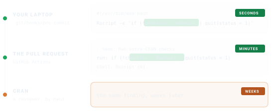

```{r}
#| label: setup
#| include: false
library(checktor)
```


You can run checktor by hand, and you will, whenever you remember to.
Continuous integration (CI) remembers for you, on every push and pull request,
for every contributor. CI asks checktor two questions. `checkup()` answers
whether the build should pass. `ci_report()` answers where the problems are, by
putting each finding on the line that caused it.

## Gate the build on `checkup()`

`checkup()` gives a CI gate its one answer, pass or fail. It runs the full
diagnosis without printing and returns `TRUE` when the package is in good
overall health. By default that means no policy or robustness finding remains,
and opinion findings do not count against it.

```{r}
#| label: scenario
# A throwaway package that deliberately uses T/F instead of TRUE/FALSE
bad_pkg <- example_diagnose_scenario("code_examples/tf_usage_bad.R",
                                     show_content = FALSE)

checkup(bad_pkg)
```

This package returns `FALSE`, and a healthy one returns `TRUE`. That is all a
build needs to decide between green and red.

## Annotate the diff with `ci_report()`

Red tells you that something failed, not what or where. `ci_report()` turns
each finding into the format your forge reads, so it appears beside the line
that caused it. These are the first three for the package above, as GitHub
Actions would receive them.

```{r}
#| label: annotations
annotations <- ci_report(path = bad_pkg, format = "github", file = NULL)
writeLines(head(annotations, 3))
```

GitHub turns each of these workflow commands into an annotation on the pull
request diff.

{.ct-fig .ct-light}
{.ct-fig .ct-dark aria-hidden="true"}

In a job, call it with no arguments. It examines the package in the working
directory, detects the CI service from the environment variables it sets and
writes the matching format.

```r
checktor::ci_report()
```

GitHub expects the colon in the title escaped as `%3A`. Gitea and Forgejo
Actions read the same commands, so the same call covers them. `ci_report()` also
detects GitLab, Azure Pipelines and Jenkins from the environment variables they
set. Pass `format` to choose a different output, such as SARIF for GitHub code
scanning, or when the build runs on a service `ci_report()` does not detect.

| Forge | Format | What to do with it |
|---|---|---|
| GitHub, Gitea, Forgejo | `"github"` | Printed to the log, shown on the diff |
| GitLab | `"gitlab"` | Name it in `artifacts:reports:codequality:` |
| Azure Pipelines | `"azure"` | Printed to the log |
| Jenkins, reviewdog, review bots | `"checkstyle"` | Read the XML with the warnings plugin |
| GitHub code scanning | `"sarif"` | Upload with `github/codeql-action/upload-sarif` |

GitLab needs only this job.

```yaml
checktor:
  image: rocker/r-ver:latest
  script:
    - Rscript -e 'install.packages("checktor"); checktor::ci_report(format = "gitlab")'
  artifacts:
    reports:
      codequality: gl-code-quality-report.json
```

`ci_report()` reports findings of every severity, because an annotation informs
and decides nothing. Leave the pass or fail decision to `checkup()`, so that
what fails a build stays separate from what gets annotated. To let an opinion
finding fail a build, use `checkup(severity = c("policy", "robustness",
"opinion"))`. The threshold then lives in one place rather than in two that can
disagree.

Checks that did not run appear once, at the end, rather than as one annotation
each, so they do not compete for space with the findings.

```{r}
#| label: skipped-notice
writeLines(tail(annotations, 1))
```

The report formats (GitLab, Checkstyle and SARIF) send that note to the job log
instead, which keeps the artifact a clean document. Pass `skipped = FALSE` to
leave it out.

## Add a GitHub Actions job

Save this file as `.github/workflows/checktor.yaml`. On every push and pull
request it examines the package once, annotates the diff, then passes or fails
the build.

```yaml
name: checktor

on:
  push:
    branches: [main, master]
  pull_request:

jobs:
  checktor:
    runs-on: ubuntu-latest
    steps:
      - uses: actions/checkout@v7

      - uses: r-lib/actions/setup-r@v2
        with:
          use-public-rspm: true

      - uses: r-lib/actions/setup-r-dependencies@v2
        with:
          extra-packages: any::checktor

      - name: Run extra-CRAN checks
        shell: Rscript {0}
        run: |
          results <- checktor::checktor(verbose = FALSE, progress = FALSE)
          checktor::ci_report(results)
          if (!checktor::is_healthy(results)) quit(status = 1)
```

The job checks out your package and installs R, its dependencies and checktor.
`ci_report()` then annotates the diff, and the build fails when the package is
not in good overall health. `is_healthy()` gives the same answer as `checkup()`
from the result the job already holds, so the package is examined only once.

> `any::checktor` installs the CRAN release. For the development version, use
> `coatless-rpkg/checktor`, which installs from GitHub.

## Fail loudly

Annotations sit on the diff. To put the whole diagnosis in the log as well,
print the report before you quit.

```r
results <- checktor::checktor()

if (!checktor::is_healthy(results)) {
  writeLines(checktor::health_report(results))  # the diagnosis, in the log
  quit(status = 1)                              # then fail the build
}
```

`health_report()` returns the findings as Markdown, so a failing log reads like
the chart at the foot of a hospital bed, with what is wrong and where. Give it a
`file` and it also writes the report there, ready to upload as a build artifact
for anyone who would rather not read CI logs.

## Tune the examination

CI logs are long enough already. `configure_doctor()` sets the default verbosity
and progress display once, at the top of a script, and every later call inherits
them.

```r
checktor::configure_doctor(verbose_default = FALSE, progress_default = FALSE)
```

To gate on one category, call its `diagnose_*()` function, and to gate on one
check, call its `lab_*()` function.

```r
# Gate only on DESCRIPTION-field problems
desc <- checktor::diagnose_description_issues(".", verbose = FALSE)
if (!checktor::is_healthy(desc)) quit(status = 1)

# Or on one check on its own
tf <- checktor::lab_tf_usage(".", verbose = FALSE)
if (!checktor::is_healthy(tf)) quit(status = 1)
```

`is_healthy()` on a category or a single check does not filter by severity, so
any finding fails it, opinion included. Use `checkup()` when severity should
decide.

## Keep the report

`health_report()` writes the full report to a file, which an artifact step can
keep. Write it in the step that runs the gate, before the gate decides.

```yaml
      - name: Run extra-CRAN checks
        shell: Rscript {0}
        run: |
          results <- checktor::checktor(verbose = FALSE, progress = FALSE)
          checktor::ci_report(results)
          invisible(checktor::health_report(results, file = "checktor-report.md"))
          if (!checktor::is_healthy(results)) quit(status = 1)

      - name: Upload checktor report
        if: always()
        uses: actions/upload-artifact@v7
        with:
          name: checktor-report
          path: checktor-report.md
```

The first step writes the report before the gate runs. The upload step runs
with `if: always()`, so a failing build still leaves its findings behind after
the log has scrolled away. checktor's own workflow does the same.

## Expect skipped checks

Some checks sit out in CI, because their result would describe the runner rather
than your package. The URL fetch runs only at the console, and spelling runs
only where a spell-check backend is installed. Neither is reported as a pass.
Each comes back marked in the `skipped` column of `tidy()` and listed in
`metadata$skipped_checks`, and `ci_report()` adds the notice shown above to the
build, so green never implies a check that did not happen.

To fetch URLs in a job, turn the check on, and accept that a network hiccup can
then turn the build red.

```r
options(checktor.url_check = TRUE)
```

## Check before you commit

CI is the backstop. To hear about a problem before it reaches a pull request,
run the same one-liner as a Git pre-commit hook.

```bash
#!/usr/bin/env bash
# .git/hooks/pre-commit  (make it executable: chmod +x .git/hooks/pre-commit)
Rscript -e 'if (!checktor::checkup()) quit(status = 1)'
```

Commits that would have embarrassed you on CRAN then never leave your laptop.
The call is the same in both places. What changes is how long you wait to hear
about a problem.

{.ct-fig .ct-light}
{.ct-fig .ct-dark aria-hidden="true"}

## See also

- [Getting Started with checktor](getting-started-with-checktor.html): a tour of
  the diagnostics from a first checkup to a written report.
- [Writing Your Own Checks](writing-checks.html): add project-specific checks
  against the parsed syntax tree.
